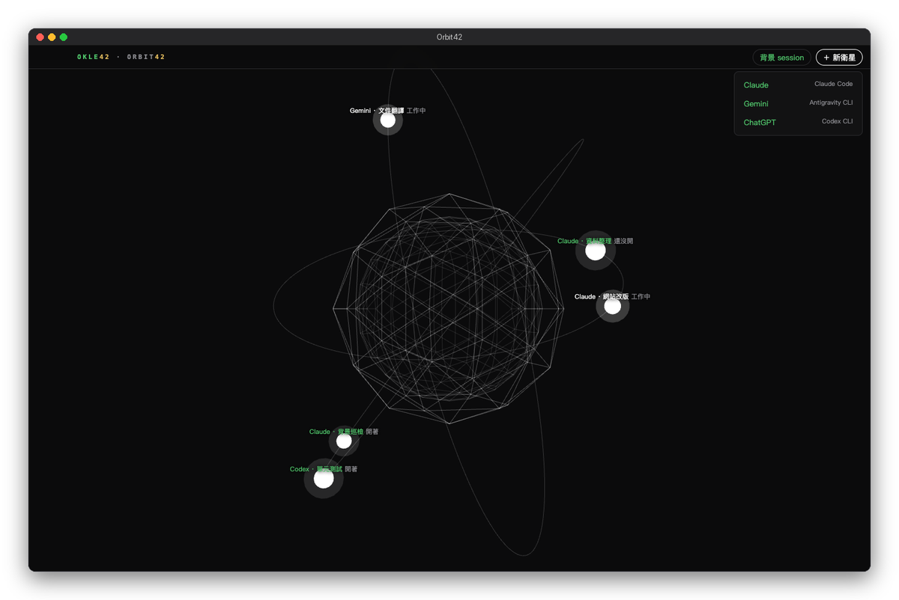
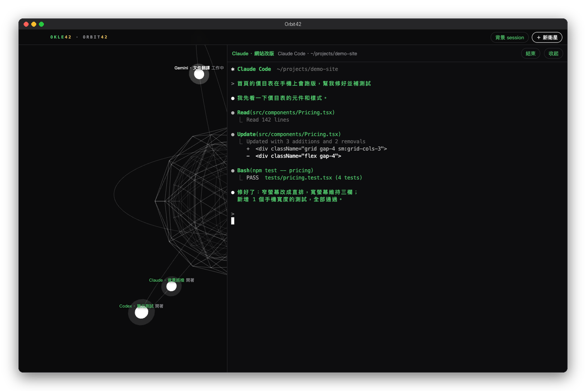
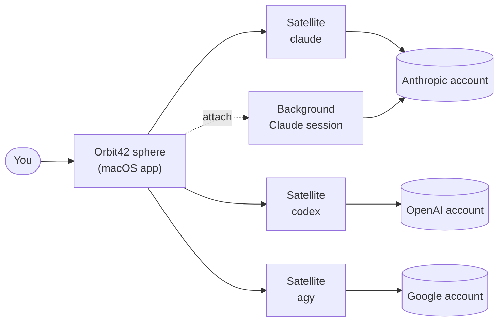

# Orbit42

**One sphere, many AI brains.** Sign in with the AI accounts you already have — Claude, ChatGPT, Gemini, Grok — and every AI worker becomes a satellite orbiting the sphere. Click a satellite and its real terminal opens right next to it. No more hunting through a dozen terminal windows.

Part of the **42 series** by [Okle42](https://github.com/Okle42) · [繁體中文說明](README.zh-TW.md)

<p align="center">
  
</p>

> [!NOTE]
> **Status: early (S1).** The sphere, new satellites and per-satellite terminals work; provider sign-in and the shared dashboard are next. See [docs/SPEC.md](docs/SPEC.md) (Chinese) for the roadmap.

> [!IMPORTANT]
> **Source-available, not open source.** Read it and try it for personal use; no commercial use or redistribution. See [LICENSE](LICENSE).

## At a glance

| | |
|---|---|
| 🛰️ **Satellites** | Each AI worker is a satellite. Busy ones glow and orbit faster; idle ones drift. |
| 🖥️ **Real terminals** | Click a satellite and its terminal slides in — exactly what the agent shows in a normal terminal. |
| 🔑 **Your accounts** | Runs each provider's official CLI, so sign-in, limits and updates stay theirs. Orbit42 never sees your keys. |
| 🌙 **Background sessions** | Pull in Claude Code sessions already running in the background; closing the view leaves them running. |
| 📱 **iPhone** | Pair the iPhone app to watch and type into the same satellites from your phone. |

## Click a satellite, get its terminal

<p align="center">
  
</p>

The sphere slides aside and the satellite's terminal opens on the right. **Collapse** hides the terminal while the satellite keeps working; **End** stops it (a pulled-in background session is only detached, never killed).

## How it works



- **Your brain, your account.** Orbit42 doesn't ship its own AI. Each satellite runs the provider's official agent — Claude Code (`claude`), OpenAI Codex CLI (`codex`), Google Antigravity CLI (`agy`) — so sign-in, tools, limits and updates are the provider's own.
- **Satellites are real terminals.** Each one is a pseudo-terminal rendered with [xterm.js](https://xtermjs.org).
- **Background sessions too.** Running Claude Code background sessions can be pulled in as satellites (`claude attach`).
- **Engine.** Session state, usage, audits and the sphere live in [`Engine/`](Engine/) (copied from ShoWork42 on 2026-11-24; independent since).

## Roadmap

| Stage | What | |
|---|---|---|
| S1 | Sphere + "New satellite" + a real terminal per satellite | ◀ now |
| S2 | Brain adapters: status, resume and usage for Claude → Codex → Antigravity (Gemini) → Grok | |
| S3 | First-run sign-in with each provider's official login | |
| S4 | Built-in throttle gate and fan guard (from [cool42](https://github.com/Okle42/cool42)) | |
| S5 | Fully standalone: everything you need in Orbit42 alone | |

## Build and run

Requires macOS 14+, Swift 6, and at least one provider CLI installed (e.g. Claude Code).

```bash
swift build
.build/debug/Orbit42
```

Everyday scripts (in `scripts/`):

| Script | What it does |
|---|---|
| `scripts/build_app.sh` | Release build → `~/Applications/Orbit42.app` (+ Desktop shortcut) |
| `scripts/restart_app.sh "reason"` | Quit and reopen the installed app (log: `~/Library/Logs/Orbit42/restart.log`) |
| `scripts/phone_pair.sh` | Show the QR code / URL for pairing the iPhone app (`ios/`, see `ios/README.md`) |

The engine and the sphere are in `Engine/`; no other repo is needed.

## Credits

[xterm.js](https://github.com/xtermjs/xterm.js) (MIT) and [three.js](https://github.com/mrdoob/three.js) (MIT) are vendored under `Web/vendor/` with their licenses. Screenshots use demo data.

## License

Source-available, **not open source** — © 2026 Okle42. You may read the code and run it for personal, non-commercial evaluation; commercial use, modification and redistribution are not permitted without written permission. See [LICENSE](LICENSE).
