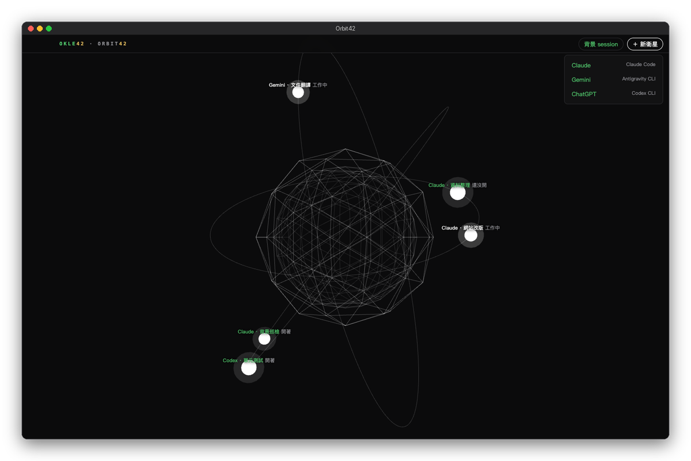
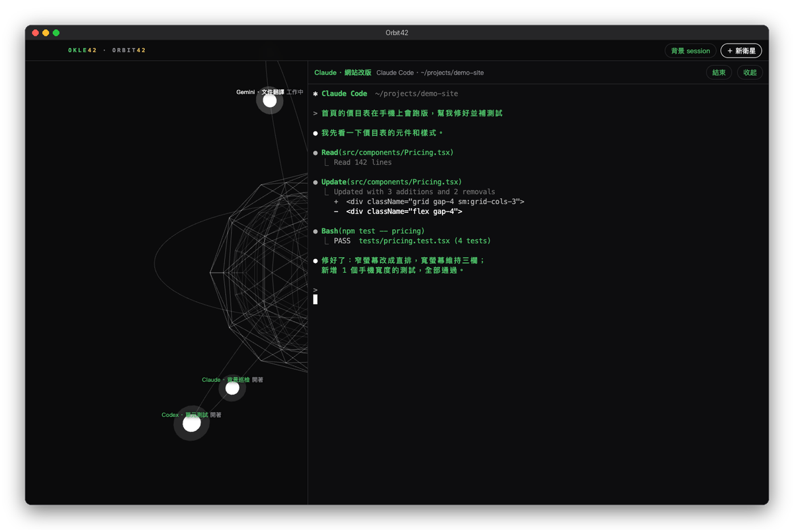
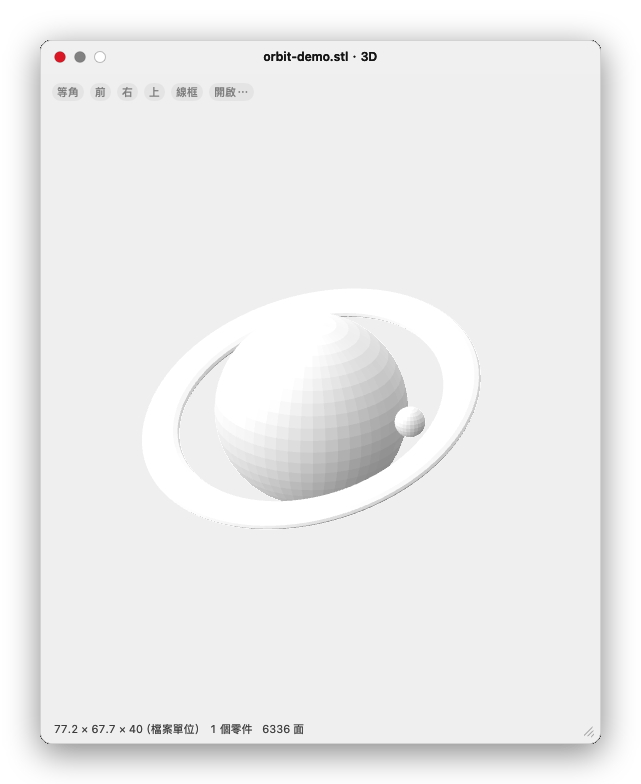
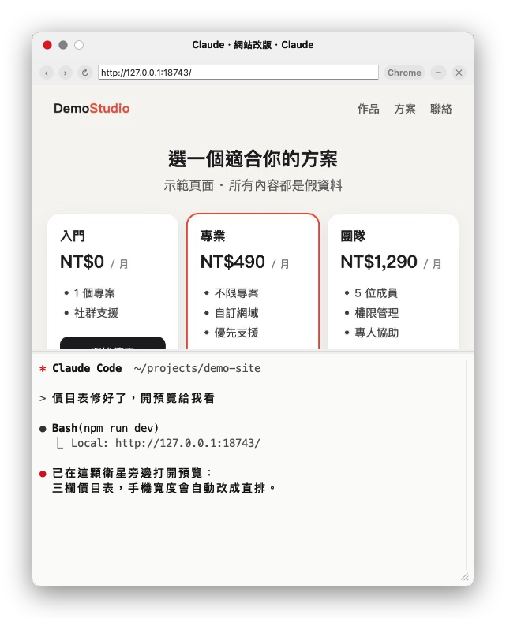
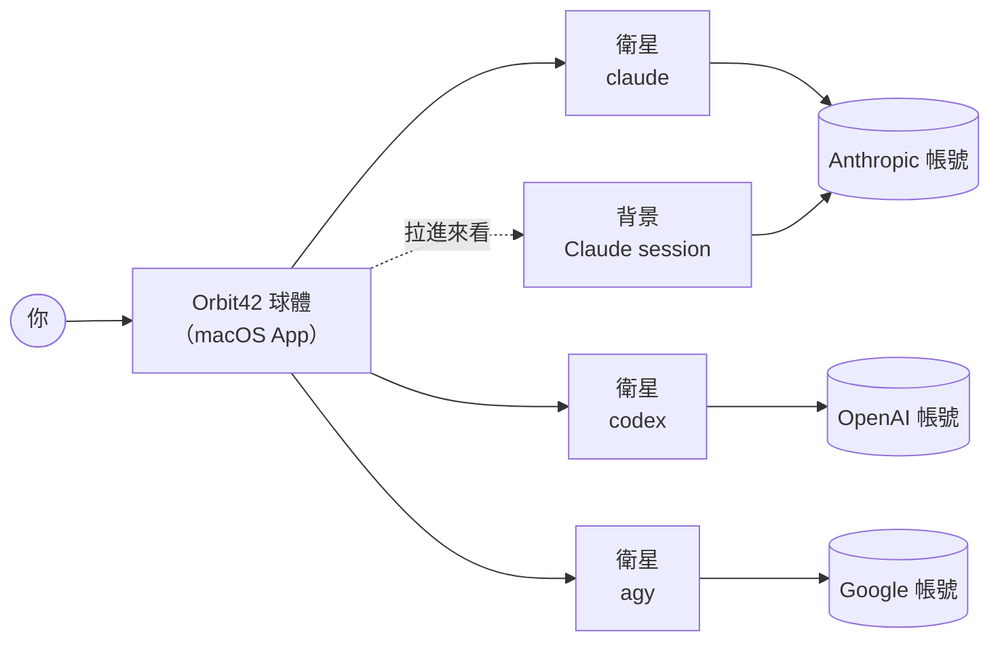

# Orbit42

**一顆球，接上各家 AI 的大腦。** 用你已經有的 AI 帳號登入——Claude、ChatGPT、Gemini、Grok——每個 AI 工作者都是一顆繞著球轉的衛星。點衛星，它真的終端機就在旁邊打開，不用再在一堆終端機視窗裡找。

**42 系列**作品之一，作者 [Okle42](https://github.com/Okle42) · [English](README.md)

<p align="center">
  
</p>

> [!NOTE]
> **狀態：早期（S1）。** 球體、開新衛星、每顆衛星自己的終端機已經能用；各家帳號登入和總覽面板是下一步。路線圖見 [docs/SPEC.md](docs/SPEC.md)。

> [!IMPORTANT]
> **原始碼公開，不是開源。** 可以閱讀、個人試用；不可商用或散布。見 [LICENSE](LICENSE)。

## 一眼看懂

| | |
|---|---|
| 🛰️ **衛星** | 每個 AI 工作者是一顆衛星。工作中的會發亮、轉得比較快；閒著的慢慢飄。 |
| 🖥️ **真的終端機** | 點衛星，終端機從右邊滑出來，看到的跟一般終端機裡一模一樣。 |
| 🔑 **用你自己的帳號** | 跑的是各家官方的 CLI，登入、額度、更新都是各家自己的；Orbit42 不經手你的金鑰。 |
| 🌙 **背景 session** | 已經在背景跑的 Claude Code session 可以拉進來看；關掉只關檢視，它照常跑。 |
| 📱 **iPhone** | 配對 iPhone App，在手機上看同一批衛星、也能打字。 |

## 點衛星，就是它的終端機

<p align="center">
  
</p>

球體讓到左邊，右邊打開這顆衛星的終端機。按 **收起** 只是收起畫面，衛星繼續跑；按 **結束** 才會停掉（拉進來看的背景 session 只會斷開檢視，不會被關掉）。

## 3D 模型直接在 Orbit42 裡看

<p align="center">
  
</p>

按 <kbd>⌘O</kbd>（或把檔案拖進來）就能用 3D 小視窗打開 STL、OBJ、PLY、USDZ 等格式，標題列跟終端機一樣。也能直接開在衛星裡，AI 做出來的 3D 檔就在它的終端機旁邊看。

## 衛星裡開真的 Chrome

<p align="center">
  
</p>

衛星可以在終端機上方打開網頁——背景跑的是真的 Chrome（無頭模式），AI 做出來的預覽就在它工作的地方看。用自己的 Chrome 設定檔，跟你平常的瀏覽器分開，也不開任何網路埠。

## 怎麼運作



- **用你自己的大腦、自己的帳號。** Orbit42 不自帶 AI。每顆衛星跑的是各家官方的 AI 工作程式——Claude Code（`claude`）、OpenAI Codex CLI（`codex`）、Google Antigravity CLI（`agy`）——登入、工具、額度、更新都是各家自己的。
- **衛星就是真的終端機。** 每顆衛星是一個虛擬終端機，用 [xterm.js](https://xtermjs.org) 畫出來。
- **背景 session 也拉得進來。** 已經在背景跑的 Claude Code session 可以拉進來當衛星（`claude attach`）。
- **引擎。** session 狀態、額度、自檢的引擎和球體在 [`Engine/`](Engine/)（2026-11-24 從 ShoWork42 搬入，之後各自獨立）。

## 路線圖

| 階段 | 內容 | |
|---|---|---|
| S1 | 球體＋「新衛星」＋每顆衛星一個真終端機 | ◀ 現在 |
| S2 | 大腦接口：Claude → Codex → Antigravity（Gemini）→ Grok 的狀態、續接、額度 | |
| S3 | 第一次打開時用各家官方登入 | |
| S4 | 內建降頻閘門與風扇守護（來自 [cool42](https://github.com/Okle42/cool42)） | |
| S5 | 完全獨立：只開 Orbit42 就能工作 | |

## 建置與執行

需要 macOS 14 以上、Swift 6，以及至少一家的 AI 工具（例如 Claude Code）。

```bash
swift build
.build/debug/Orbit42
```

常用腳本（`scripts/`）：

| 腳本 | 做什麼 |
|---|---|
| `scripts/build_app.sh` | 正式版編譯 → `~/Applications/Orbit42.app`（桌面放捷徑） |
| `scripts/restart_app.sh "原因"` | 結束並重新打開已安裝的 App（紀錄：`~/Library/Logs/Orbit42/restart.log`） |
| `scripts/phone_pair.sh` | 顯示 iPhone App 配對用的 QR code／網址（`ios/`，見 `ios/README.md`） |

引擎和球體的原始碼都在 `Engine/`，不需要另外的 repo。

## 致謝

[xterm.js](https://github.com/xtermjs/xterm.js)（MIT）與 [three.js](https://github.com/mrdoob/three.js)（MIT）放在 `Web/vendor/`，附原授權。截圖用的是示範資料。

## 授權

原始碼公開，**不是開源**——© 2026 Okle42。可以閱讀程式碼、在自己電腦上個人非商業試用；未經書面同意不得商用、修改後散布或轉散布。見 [LICENSE](LICENSE)。
